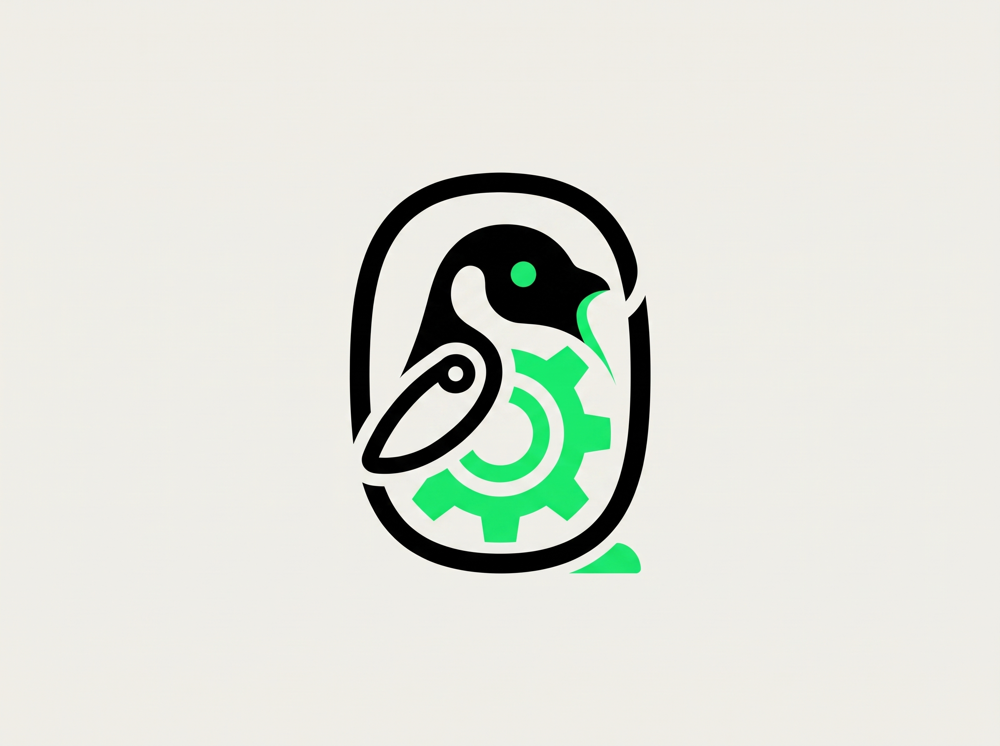
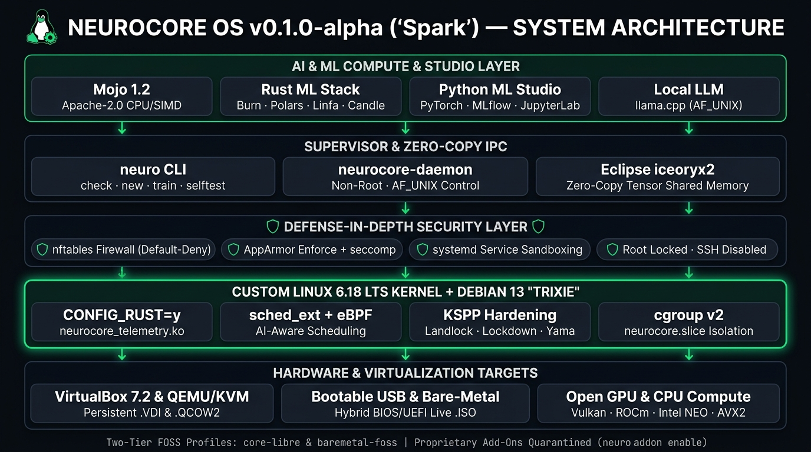
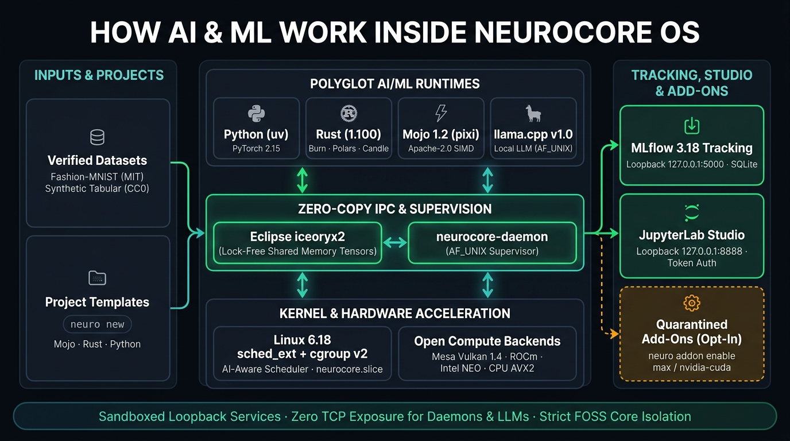
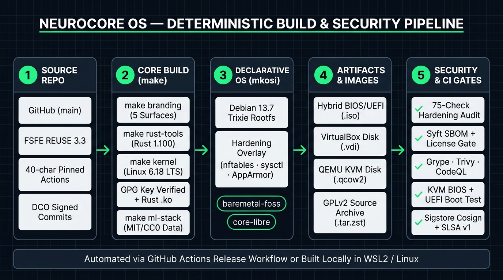
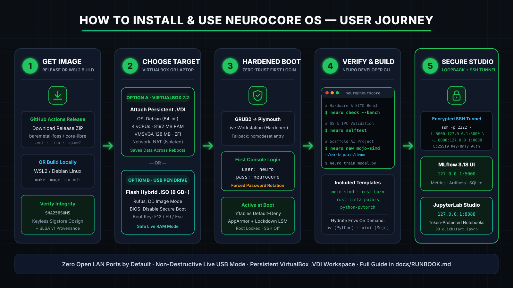

<!--
SPDX-FileCopyrightText: 2026 NeuroCore OS Contributors
SPDX-License-Identifier: CC-BY-4.0
-->

<p align="center">
  
</p>

<h1 align="center">NeuroCore OS v0.1.0-alpha ("Spark")</h1>

<p align="center">
  <strong>Hardened, Free &amp; Open-Source AI/ML Operating System</strong><br />
  Debian 13.7 "Trixie" · Custom Linux 6.18 LTS (<code>CONFIG_RUST=y</code> + <code>sched_ext</code>) · Mojo 1.2 · Rust ML · PyTorch + MLflow · Local <code>llama.cpp</code> · Eclipse <code>iceoryx2</code>
</p>

<p align="center">
  <a href="https://github.com/HemalTharakaeEranga/neurocore-os/actions/workflows/security-audit.yml"></a>
  <a href="https://github.com/HemalTharakaeEranga/neurocore-os/actions/workflows/reuse-and-sbom.yml"></a>
  <a href="https://github.com/HemalTharakaeEranga/neurocore-os/actions/workflows/ci-build-test.yml"></a>
  <a href="https://github.com/HemalTharakaeEranga/neurocore-os/actions/workflows/release-iso.yml"></a>
</p>

---

**NeuroCore OS** pairs **Debian 13.7 "Trixie"** (`glibc 2.41`) with a custom-compiled, KSPP-hardened **Linux 6.18 LTS** kernel (`CONFIG_RUST=y`, `CONFIG_SCHED_CLASS_EXT=y`), declarative **mkosi** image generation, dual-toolchain Rust support, standalone Apache-2.0 **Mojo 1.2.0** CPU/SIMD kernels, cross-vendor open GPU compute (**Mesa Vulkan 1.4 / RADV / ANV / NVK / Rusticl**, **ROCm 10.x** open user space, **Intel NEO**), **Burn / Polars / Linfa / Candle**, **PyTorch 2.15.0 + MLflow 3.18.0**, **llama.cpp v1.0.0** over Unix domain sockets, and lock-free **Eclipse iceoryx2** zero-copy tensor IPC.

## System Architecture



## How AI & ML Work Inside NeuroCore OS

Polyglot AI/ML workloads (Python `uv`, Rust `1.100`, standalone Apache-2.0 Mojo `1.2`, and local `llama.cpp`) exchange tensors over lock-free **Eclipse iceoryx2** shared memory under non-root **AppArmor-confined** `neurocore-daemon` supervision, scheduled by Linux 6.18 **`sched_ext` + cgroup v2**, with experiment tracking (`MLflow`) and notebooks (`JupyterLab`) isolated strictly to loopback (`127.0.0.1`).



## How NeuroCore OS Is Built & Verified

Every release ISO, VirtualBox `.vdi`, and QEMU `.qcow2` is assembled deterministically from this repository—either automatically in **GitHub Actions** or locally inside **WSL2 / Linux**—and gated by 75 OS hardening checks, Syft SBOM license verification, Grype/Trivy/CodeQL vulnerability scans, dual-firmware KVM boot tests, and keyless Sigstore signing.



## How to Install & Use NeuroCore OS (User Journey)

Follow the visual 5-step flow below, or open the full copy-pasteable guide in **[docs/RUNBOOK.md](docs/RUNBOOK.md)**.



## Two-Tier FOSS Build Profiles

NeuroCore OS enforces strict license transparency across hardware boundaries:

| Profile | Debian Repos | Included Stack | Quarantined Add-Ons |
| --- | --- | --- | --- |
| `core-libre` | `main` only (zero `non-free-firmware`) | Standalone Apache-2.0 Mojo 1.2 CPU/SIMD, Burn, Polars, Linfa, Candle, PyTorch CPU, llama.cpp CPU/Vulkan (Lavapipe), MLflow, JupyterLab | Modular MAX, NVIDIA CUDA, vendor firmware blobs |
| `baremetal-foss` (default) | `main`, `non-free-firmware` | Everything in `core-libre` + redistributable GPU microcode blobs, Mesa RADV/ANV/NVK/Rusticl, open ROCm 10.x (excluding AMD `proprietary/`), MIT Intel Compute Runtime | Modular MAX (`neuro addon enable max`), NVIDIA CUDA (`neuro addon enable nvidia-cuda`) |

Neither profile pre-bundles Modular MAX (source-available MAX License), proprietary NVIDIA CUDA user-space libraries, or third-party LLM weights.

## Documentation & Quickstart Guides

- **[docs/RUNBOOK.md](docs/RUNBOOK.md)** — Complete step-by-step operator & developer runbook: Git clone/pull/push/merge workflow, downloading or building `.iso`/`.vdi` images, VirtualBox 7.2 installation, bootable USB pen drive & laptop guide, and secure SSH tunneling.
- **[docs/BUILDING_WSL2.md](docs/BUILDING_WSL2.md)** — Local Windows + WSL2 build instructions.
- **[docs/SECURITY_ARCHITECTURE.md](docs/SECURITY_ARCHITECTURE.md)** — Defense-in-depth hardening audit & GitHub Actions verification workflow.

### Local Build Targets (WSL2 / Debian / Ubuntu)

```bash
make doctor          # Verify host tools (Debian/Ubuntu or WSL2)
make branding        # Generate dark-adapted CLUT224, GRUB2, Plymouth, and hicolor icons
make rust-tools      # Compile neuro, neurocore-daemon, and neuro-bench (Rust 1.100)
make kernel          # Fetch, verify, patch, and build Linux 6.18 LTS + Rust .ko
make ml-stack        # Fetch MIT Fashion-MNIST and generate CC0 synthetic tabular data
make image           # Build declarative mkosi disk image (PROFILE=baremetal-foss or core-libre)
make iso vdi qcow2   # Package reproducible tri-mode BIOS/UEFI ISO, VirtualBox .vdi, QEMU .qcow2
make sbom            # Validate Syft SPDX/CycloneDX SBOM against profile license policy
make gpl-sources     # Collect GPLv2 Section 3 Complete Corresponding Source archive
make verify          # Run headless QEMU/KVM BIOS + UEFI smoke tests
```

### VirtualBox 7.2 Quickstart

1. Download **`neurocore-release-baremetal-foss`** from [GitHub Actions Releases](https://github.com/HemalTharakaeEranga/neurocore-os/actions/workflows/release-iso.yml) (or build locally into `out/`).
2. Create a **Linux → Debian (64-bit)** VM with **4 vCPUs**, **8192 MB RAM**, **128 MB VMSVGA**, **NAT**, and **EFI enabled** (Legacy BIOS also works).
3. Attach `neurocore-0.1.0-alpha-baremetal-foss-amd64.vdi` (persistent disk) or boot the hybrid `.iso`.
4. Log in on console as `neuro` / `neurocore` (forced password rotation on first login), then run:
   ```bash
   neuro check --bench
   neuro selftest
   neuro new mojo-simd ~/workspace/demo
   ```
5. To open loopback-hardened **MLflow (`:5000`)** and **JupyterLab (`:8888`)** from your Windows host browser safely, follow the key-only SSH tunnel steps in **[docs/RUNBOOK.md § 3.7](docs/RUNBOOK.md#37-opening-mlflow-5000--jupyterlab-8888-safely-from-windows)**.

## Repository Layout

- `Icon.jpg` & `branding/` — Master penguin-and-gear artwork (`CC-BY-SA-4.0`) and 5-surface dark-mode asset compiler (kernel CLUT224, GRUB2, Plymouth boot animation, hicolor desktop icons, MOTD).
- `docs/` — Operator runbook, WSL2 build guide, security architecture log, and `docs/diagrams/` visual architecture diagrams (`CC-BY-4.0`).
- `kernel/` — Linux 6.18 LTS (+ `next` 7.3+) Kconfig fragments, clean patches, and `neurocore_telemetry` Rust kernel module (`GPL-2.0-only`).
- `rust/` — Cargo workspace (`Rust 1.100`) containing `neuro-cli`, `neurocore-daemon`, and `neuro-bench` (`MIT OR Apache-2.0`).
- `mojo/` — Standalone Mojo 1.2.0 CPU/SIMD kernels and C-ABI `iceoryx2` tensor bridge (`Apache-2.0 WITH LLVM-exception`).
- `ml-stack/` — `pixi` + `uv` manifests, `llama.cpp v1.0.0` dynamic-backend build script, MIT/CC0 dataset fetchers, self-tests, and quickstart notebook.
- `mkosi/` — Declarative Debian 13 "Trixie" image builder, profiles, chroot post-install, and FHS 3.0 `/etc`/`/usr` hardening overlay.
- `packaging/` — Reproducible Zstd SquashFS + tri-mode BIOS/UEFI `grub-mkrescue` ISO, `.vdi`, `.qcow2`, and GPLv2 CCS packager.
- `tests/` & `.github/workflows/` — KVM BIOS/UEFI QEMU smoke tests, VirtualBox smoke tests, 75-check security hardening gate, SBOM license policy gate, REUSE 3.3 lint, Grype/Trivy/CodeQL scans, and keyless Sigstore signing.

## Licensing & Governance

NeuroCore OS adheres to **FSFE REUSE 3.3** (`reuse lint`). See [LICENSE](LICENSE), [LICENSING.md](LICENSING.md), [REUSE.toml](REUSE.toml), [TRADEMARKS.md](TRADEMARKS.md), [CONTRIBUTING.md](CONTRIBUTING.md), [GOVERNANCE.md](GOVERNANCE.md), and [SECURITY.md](SECURITY.md).
