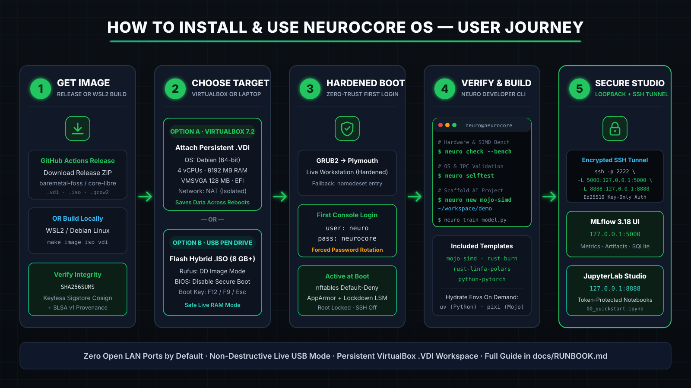

<!--
SPDX-FileCopyrightText: 2026 NeuroCore OS Contributors
SPDX-License-Identifier: CC-BY-4.0
-->

# NeuroCore OS v0.1.0-alpha ("Spark") — Operator & Developer Runbook



This step-by-step runbook covers everything you need to:

1. **Clone, pull, branch, commit, push, and merge** code cleanly with Git & GitHub.
2. **Download or build** bootable NeuroCore OS `.iso` (Live BIOS/UEFI) and `.vdi` (VirtualBox disk) images.
3. **Install and run NeuroCore OS in VirtualBox 7.2** on Windows, macOS, or Linux.
4. **Create a bootable USB pen drive and boot on a real laptop** safely.
5. **Verify OS security hardening, run AI/ML self-tests, and troubleshoot** common issues.

---

## 1. Git & GitHub Step-by-Step Workflow (Clone, Pull, Push, Merge)

### 1.1 One-Time Git Configuration (Windows / Linux / macOS)

NeuroCore OS enforces **LF (`\n`) line endings** for all Linux scripts, patches, and configs (via `.gitattributes`) and requires **Developer Certificate of Origin (`Signed-off-by`)** on every commit.

```bash
git config --global user.name "Your Name"
git config --global user.email "your-email@example.com"
# Keep Linux LF line endings cleanly on Windows (never convert to CRLF):
git config --global core.autocrlf input
```

### 1.2 Clone the Repository (First Time Only)

```bash
git clone https://github.com/HemalTharakaeEranga/neurocore-os.git
cd neurocore-os
git branch -a
```

### 1.3 Pull the Latest `main` Branch Safely

Always update `main` before starting new work:

```bash
git checkout main
git fetch --all --prune
git pull --ff-only origin main
git status
```

> **Tip:** `--ff-only` guarantees your local `main` mirrors `origin/main` cleanly without accidental merge commits.

### 1.4 Make Changes on a Feature Branch, Test, Commit & Push

Never push untested edits directly to `main`. Create a short-lived branch, run the local security & compliance checks, commit with `-s` (DCO sign-off), and push:

```bash
# 1. Create and switch to a new branch from updated main
git checkout -b feat/my-improvement

# 2. Edit files, then verify security & compliance locally before committing
python3 tests/verify-security-hardening.py
python3 tests/verify-sbom-licenses.py --self-test

# 3. Inspect exactly what changed
git status
git diff

# 4. Stage specific files and commit with DCO sign-off (-s)
git add path/to/changed-file
git commit -s -m "feat(scope): clear summary of change"

# 5. Push your branch to GitHub
git push -u origin feat/my-improvement
```

### 1.5 Open a Pull Request, Verify CI & Merge into `main`

Using the **GitHub CLI (`gh`)** (or the GitHub web UI **Pull requests -> New pull request**):

```bash
# Open a PR targeting main
gh pr create --base main --fill

# Watch all automated security, REUSE, Rust, and KVM ISO boot checks
gh pr checks --watch

# Once all checks are green, merge and delete the remote feature branch
gh pr merge --merge --delete-branch
```

Then sync your local repository back to the updated `main`:

```bash
git checkout main
git fetch --all --prune
git pull --ff-only origin main
git branch -d feat/my-improvement
```

### 1.6 Sync a Secondary Branch (e.g. `v0.1.0-alpha-spark`) with `main`

If you maintain another tracking branch alongside `main`, keep it fast-forwarded so branches never diverge:

```bash
git checkout main
git pull --ff-only origin main
git checkout v0.1.0-alpha-spark
git merge --ff-only main
git push origin v0.1.0-alpha-spark
git checkout main
```

### 1.7 Quick Fixes for Common Git Errors

| Error | Cause | Exact Fix |
| --- | --- | --- |
| `! [rejected] ... (fetch first)` / `non-fast-forward` | Remote branch has newer commits than your local copy. | Run `git fetch origin` then `git pull --rebase origin <branch>` (or `git pull --ff-only origin main` on `main`), resolve any conflict, then push again. |
| `error: Your local changes ... would be overwritten by checkout/merge` | Uncommitted edits conflict with incoming commits. | Save them temporarily with `git stash push -m "wip"`, pull/checkout cleanly, then restore with `git stash pop`. |
| `CRLF will be replaced by LF` / CI fails on CRLF | Windows editor saved `\r\n` endings in a Linux script or config. | Run `git add --renormalize .` and ensure your editor uses **LF** (`\n`). |
| `cannot lock ref` / `index.lock: File exists` | Another Git process or IDE hook is running. | Close competing Git processes; only remove `.git/index.lock` if no `git` process is running. |

---

## 2. How to Get Bootable `.iso` and `.vdi` Images

The Git repository stores build recipes, kernel configs, Rust/Mojo/Python code, and hardening overlays—not multi-gigabyte binary disk images. Choose your profile first:

| Profile | Debian Repos | Best For |
| --- | --- | --- |
| `baremetal-foss` *(default)* | `main`, `non-free-firmware` | Real laptops, desktops, AMD/Intel/open-NVK GPUs, Wi-Fi/NIC firmware, VirtualBox |
| `core-libre` | `main` only *(zero firmware blobs)* | Strict 100% Debian-main FOSS audits, VirtualBox & QEMU/KVM VMs |

### Option A (Easiest on Windows): Download Prebuilt Images from GitHub Actions

No local Linux or WSL2 setup is needed:

1. Open **https://github.com/HemalTharakaeEranga/neurocore-os/actions** in your browser.
2. In the left sidebar, click **Release ISO, VDI, QCOW2, GPLv2 CCS & Sigstore Provenance**.
3. Click **Run workflow** -> select branch **`main`** -> click **Run workflow** *(or push a release tag like `git tag v0.1.0-alpha && git push origin v0.1.0-alpha`)*.
4. Wait for the `baremetal-foss` and `core-libre` matrix jobs to turn green.
5. Scroll down to **Artifacts** and download **`neurocore-release-baremetal-foss`** (or `neurocore-release-core-libre`).
6. Extract the ZIP archive. It contains:
   - `neurocore-0.1.0-alpha-baremetal-foss-amd64.iso` *(bootable BIOS/UEFI Live ISO for VirtualBox & USB)*
   - `neurocore-0.1.0-alpha-baremetal-foss-amd64.vdi` *(ready-to-attach persistent VirtualBox disk)*
   - `neurocore-0.1.0-alpha-baremetal-foss-amd64.qcow2` *(QEMU/KVM disk image)*
   - `SHA256SUMS-baremetal-foss` + `.sigstore.json` bundles + SPDX/CycloneDX SBOMs + GPLv2 source archive
7. Verify file integrity in Windows PowerShell before booting:

```powershell
Get-FileHash .\neurocore-0.1.0-alpha-baremetal-foss-amd64.iso -Algorithm SHA256
Get-Content .\SHA256SUMS-baremetal-foss
```

Compare the printed SHA-256 hash against the matching line in `SHA256SUMS-baremetal-foss`.

### Option B: Build Locally on Windows (WSL2) or Native Debian/Ubuntu

See [BUILDING_WSL2.md](BUILDING_WSL2.md) for prerequisite installation. Build inside WSL2's native Linux ext4 filesystem (`~/src/neurocore-os`, **not** `/mnt/d/`):

```bash
mkdir -p ~/src
rsync -av --exclude out --exclude rust/target "/mnt/d/NeuroCore OS/" ~/src/neurocore-os/
cd ~/src/neurocore-os

make doctor
make branding
make rust-tools
make kernel
make ml-stack
make image PROFILE=baremetal-foss
make iso vdi qcow2 sbom PROFILE=baremetal-foss

# Copy finished images back to Windows for VirtualBox / Rufus:
mkdir -p "/mnt/d/NeuroCore OS/out"
cp -v out/neurocore-0.1.0-alpha-* "/mnt/d/NeuroCore OS/out/"
```

---

## 3. Running & Installing NeuroCore OS in VirtualBox 7.2

### 3.1 Host Requirements

- **VirtualBox 7.2+** installed from [virtualbox.org](https://www.virtualbox.org/).
- **CPU Virtualization** (**Intel VT-x** or **AMD-V**) enabled in your PC's BIOS/UEFI.
- At least **12 GB free host RAM** (8 GB allocated to the VM) and **25 GB free disk space**.
- *(Windows tip)* If VirtualBox shows a green turtle icon in the bottom-right status bar and runs slowly, Windows Hyper-V / Memory Integrity is nesting VirtualBox. It will still boot, or you can test inside QEMU/KVM on Linux/WSL2.

### 3.2 Method A — Persistent VirtualBox Installation using `.vdi` (Recommended)

The `.vdi` image is a ready-to-boot GPT disk (EFI System Partition + ext4 root) that saves all your code, password change, datasets, and installed Python/Mojo environments across reboots:

1. Open **Oracle VirtualBox** and click **New**.
2. **Name and Operating System**:
   - **Name**: `NeuroCore-OS-Spark`
   - **Type**: `Linux`
   - **Version**: `Debian (64-bit)`
3. **Hardware**:
   - **Base Memory**: `8192 MB` (minimum `4096 MB` for console-only testing)
   - **Processors**: `4 CPUs`
   - Check **Enable EFI (special OSes only)** *(recommended; Legacy BIOS is also supported)*
4. **Hard Disk**:
   - Select **Use an Existing Virtual Hard Disk File**.
   - Click the folder icon -> **Add** -> select `neurocore-0.1.0-alpha-baremetal-foss-amd64.vdi` -> **Choose**.
   - Click **Finish**.
5. Open **Settings** on the new VM:
   - **Display -> Screen**: Set **Video Memory** to `128 MB`, **Graphics Controller** to `VMSVGA`.
   - **Network -> Adapter 1**: Leave attached to **NAT** (outbound internet works; inbound LAN access stays blocked).
   - *(Optional, for expanding disk space)* Before starting, resize the `.vdi` to 40 GB so you have plenty of room for ML models:
     ```powershell
     & "C:\Program Files\Oracle\VirtualBox\VBoxManage.exe" modifymedium disk "D:\NeuroCore OS\out\neurocore-0.1.0-alpha-baremetal-foss-amd64.vdi" --resize 40960
     ```
6. Click **Start** to boot NeuroCore OS.

### 3.3 Method B — Booting the Hybrid Live `.iso` in VirtualBox

Use this to test the read-only Live Workstation (changes stay in RAM and reset on shutdown):

1. Create a VM with the same settings (**Debian 64-bit**, **8192 MB RAM**, **4 CPUs**, **Enable EFI**, **VMSVGA 128 MB**, **NAT**), choosing **Do Not Add a Virtual Hard Disk** (or create a dynamic disk if you want mounted scratch storage).
2. Open **Settings -> Storage**.
3. Click the **Empty** optical drive under the storage controller -> click the small blue disc icon on the right -> **Choose a disk file...** -> select `neurocore-0.1.0-alpha-baremetal-foss-amd64.iso`.
4. Click **OK** -> **Start**.
5. At the GRUB2 menu, press **Enter** on **`NeuroCore OS 0.1.0-alpha (Spark) — Live Workstation (Hardened)`**.
   - If your screen goes black or freezes during graphics init, reboot and select **`Safe CPU/VM Fallback (nomodeset)`**.

### 3.4 Automated VirtualBox VM Creation via PowerShell CLI

To create a persistent VM in seconds from Windows PowerShell (replace the `.vdi` path with yours):

```powershell
$VBox = "C:\Program Files\Oracle\VirtualBox\VBoxManage.exe"
$Vdi  = "D:\NeuroCore OS\out\neurocore-0.1.0-alpha-baremetal-foss-amd64.vdi"
$Name = "NeuroCore-OS-Spark"

& $VBox createvm --name $Name --ostype Debian_64 --register
& $VBox modifyvm $Name --cpus 4 --memory 8192 --vram 128 --graphicscontroller vmsvga --firmware efi --nic1 nat
& $VBox storagectl $Name --name "SATA" --add sata --controller IntelAhci
& $VBox storageattach $Name --storagectl "SATA" --port 0 --device 0 --type hdd --medium $Vdi
& $VBox startvm $Name --type gui
```

### 3.5 First Boot Login & Mandatory Password Change

By design, NeuroCore OS ships hardened out of the box:

- `root` password login is **locked** (`passwd -l root`).
- `ssh.service` is **disabled** by default.
- `sudo` requires your user password (`NOPASSWD:ALL` is never enabled).
- The default local console account **`neuro`** forces an immediate password change on first login (`chage -d 0 neuro`):

1. At the `neurocore login:` prompt, enter:
   - **Username:** `neuro`
   - **Password:** `neurocore`
2. You will immediately be prompted:
   - `Current password:` -> type `neurocore`
   - `New password:` -> type your strong personal password
   - `Retype new password:` -> re-type your password

### 3.6 Post-Boot Verification & AI/ML Quickstart Inside NeuroCore OS

Run these commands right after logging in:

```bash
# 1. Verify CPU x86-64-v3 SIMD (AVX2/FMA), GPUs, Vulkan/ROCm, sched_ext & run neuro-bench
neuro check --bench

# 2. Run the NeuroCore OS validation self-test suite
neuro selftest

# 3. Verify kernel hardening, firewall, AppArmor, and supervisor daemon
cat /proc/cmdline
sudo nft list ruleset
sudo aa-status
systemctl status neurocore-daemon.service

# 4. Scaffold your first project (choices: mojo-simd | rust-burn | rust-linfa-polars | python-pytorch)
neuro new mojo-simd ~/workspace/demo-simd
cd ~/workspace/demo-simd
```

#### Hydrating Optional Python ML (`uv`) & Mojo 1.2 (`pixi`) Runtimes

To keep the initial ISO lean (~600 MB) and fully auditable, `/opt/ml/envs/python-ml` and `/opt/ml/envs/mojo` are provisioned as FHS 3.0 mountpoints while full manifests live in `ml-stack/pyproject.toml` and `mojo/pixi.toml`. Inside a persistent `.vdi` (with internet access), hydrate the Python ML studio (PyTorch + MLflow + JupyterLab) or Mojo 1.2 environment when ready:

```bash
# Clone the repo inside the VM (if not already present) to access manifests:
git clone https://github.com/HemalTharakaeEranga/neurocore-os.git ~/workspace/neurocore-os

# Hydrate Python ML venv (PyTorch + MLflow + JupyterLab) with uv:
cd ~/workspace/neurocore-os/ml-stack
uv venv /opt/ml/envs/python-ml/.venv
uv pip install --python /opt/ml/envs/python-ml/.venv/bin/python -e .
sudo systemctl restart neurocore-mlflow.service neurocore-jupyter.service

# Hydrate standalone Apache-2.0 Mojo 1.2.0 CPU/SIMD toolchain with pixi:
cd ~/workspace/neurocore-os/mojo
pixi install
```

### 3.7 Opening MLflow (`:5000`) & JupyterLab (`:8888`) Safely from Windows

Because NeuroCore OS isolates `neurocore-mlflow.service` and `neurocore-jupyter.service` strictly to loopback (`127.0.0.1` + systemd `IPAddressAllow=localhost`) and drops external inbound traffic in `nftables`, external hosts **cannot** connect directly to port `5000` or `8888`.

The **most secure** way to open them in your Windows browser—without exposing MLflow or JupyterLab to your LAN—is an **encrypted SSH local port-forward tunnel** over VirtualBox NAT:

1. **Add a VirtualBox NAT rule** for SSH (loopback-only on your Windows host):
   - VM **Settings -> Network -> Adapter 1 -> Advanced -> Port Forwarding -> `+`**:
     - Name: `ssh`, Protocol: `TCP`, Host IP: `127.0.0.1`, Host Port: `2222`, Guest IP: *(blank)*, Guest Port: `22`
   - Or via PowerShell:
     ```powershell
     & "C:\Program Files\Oracle\VirtualBox\VBoxManage.exe" modifyvm "NeuroCore-OS-Spark" --natpf1 "ssh,tcp,127.0.0.1,2222,,22"
     ```
2. **Generate an Ed25519 SSH key on Windows** (skip if `~/.ssh/id_ed25519.pub` already exists):
   ```powershell
   ssh-keygen -t ed25519 -C "neurocore-vbox"
   Get-Content "$env:USERPROFILE\.ssh\id_ed25519.pub"
   ```
3. **Inside the VirtualBox VM**, install your public key and enable key-only SSH on the VirtualBox NAT interface (`10.0.2.15`):
   ```bash
   mkdir -p ~/.ssh && chmod 700 ~/.ssh
   # Paste your Windows id_ed25519.pub key into authorized_keys:
   nano ~/.ssh/authorized_keys
   chmod 600 ~/.ssh/authorized_keys

   # Allow sshd to bind to VirtualBox's NAT guest IP (still key-only, root disabled):
   echo "ListenAddress 10.0.2.15" | sudo tee /etc/ssh/sshd_config.d/99-vbox-nat.conf
   # Allow port 22 strictly from VirtualBox's NAT host gateway (10.0.2.2):
   sudo nft add rule inet neurocore_filter input ip saddr 10.0.2.2 tcp dport 22 accept
   sudo systemctl enable --now ssh.service
   ```
4. **From Windows PowerShell**, open the encrypted tunnel:
   ```powershell
   ssh -p 2222 -L 5000:127.0.0.1:5000 -L 8888:127.0.0.1:8888 neuro@127.0.0.1
   ```
5. **Open in your Windows browser**:
   - **MLflow UI:** `http://127.0.0.1:5000`
   - **JupyterLab:** `http://127.0.0.1:8888` *(find your Jupyter authentication token inside the VM with `journalctl -u neurocore-jupyter.service | grep token=`)*

---

## 4. Bootable USB Pen Drive & Bare-Metal Laptop Guide

NeuroCore OS v0.1.0-alpha ("Spark") ships as a **tri-mode hybrid BIOS/UEFI Live ISO**. Booting from USB runs completely in **RAM** and **does not modify your laptop's internal Windows/Linux drive** unless you explicitly write to it.

### 4.1 Flash the `.iso` to a USB Pen Drive (8 GB+ USB 3.x Recommended)

> **Warning:** Flashing erases all existing files on the selected USB drive. Back up your USB first and double-check the drive letter/device path.

#### On Windows (using Rufus)

1. Download **Rufus** from [rufus.ie](https://rufus.ie/).
2. Plug in your USB pen drive and open Rufus.
3. **Device**: Select your USB drive.
4. **Boot selection**: Click **SELECT** and choose `neurocore-0.1.0-alpha-baremetal-foss-amd64.iso`.
5. Click **START**.
6. When Rufus asks which mode to use, select **Write in DD Image mode** (recommended—preserves the reproducible El Torito + hybrid GPT/MBR boot layout).
7. Wait for `READY`, then safely eject the USB drive.
   - *Firmware fallback note:* Some InsydeH2O laptop firmwares ignore hybrid DD USB sticks. If your laptop BIOS does not list the USB drive, re-flash in Rufus using **Write in ISO Image mode** with **Partition scheme: GPT** and **Target system: UEFI (non CSM)**.

#### On Linux

```bash
# Identify your USB device carefully (e.g. /dev/sdX — NEVER your internal nvme0n1/sda!):
lsblk -o NAME,SIZE,MODEL,TRAN

# Flash the hybrid ISO directly:
sudo dd if=out/neurocore-0.1.0-alpha-baremetal-foss-amd64.iso of=/dev/sdX bs=4M status=progress oflag=sync
sync
```

### 4.2 Booting on Your Laptop (BIOS/UEFI Settings)

1. **Disable Secure Boot temporarily** in BIOS/UEFI settings.
   - *Why:* v0.1.0-alpha boots a custom-compiled Linux 6.18 LTS kernel (`CONFIG_RUST=y`, `CONFIG_SCHED_CLASS_EXT=y`) that is not yet signed with a Microsoft UEFI CA Shim key.
2. Insert the NeuroCore USB drive and power on (or restart) your laptop while tapping the **One-Time Boot Menu** key:
   - **Lenovo / ThinkPad / IdeaPad**: `F12` *(or Novo button)*
   - **Dell**: `F12`
   - **HP**: `F9` or `Esc` -> `F9`
   - **ASUS**: `Esc` or `F8`
   - **Acer**: `F12` *(enable F12 Boot Menu in BIOS if disabled)*
   - **MSI**: `F11`
3. Select your USB pen drive (prefer the **UEFI:** entry if available).
4. At the dark-mode NeuroCore GRUB2 menu, select:
   - **`NeuroCore OS 0.1.0-alpha (Spark) — Live Workstation (Hardened)`** *(normal boot)*
   - **`Safe CPU/VM Fallback (nomodeset)`** *(if a laptop GPU shows a black screen)*
5. Log in with `neuro` / `neurocore` and follow the prompt to set your session password.

### 4.3 Installing Persistently to a Dedicated Disk or Fast External USB-SSD

v0.1.0-alpha ("Spark") does not yet ship an interactive graphical disk installer (Calamares/guided installer is planned for a subsequent release). To run persistently on bare metal without touching your Windows SSD, write the **`mkosi` `.raw` GPT disk image** (or convert `.vdi` -> `.raw` via `qemu-img convert -f vdi -O raw`) directly onto a **dedicated secondary SSD or external USB-SSD** from Linux:

```bash
# 1. Verify the target disk is ONLY your dedicated secondary/external disk (e.g. /dev/sdb):
lsblk -o NAME,SIZE,MODEL,TRAN

# 2. Write the GPT disk image to the dedicated target disk:
sudo dd if=out/neurocore-os-baremetal-foss_0.1.0-alpha.raw of=/dev/sdX bs=4M status=progress oflag=sync
sync

# 3. (Optional) Expand the GPT backup header & root ext4 partition to fill the disk:
sudo sgdisk -e /dev/sdX
sudo growpart /dev/sdX 2
sudo e2fsck -f /dev/sdX2
sudo resize2fs /dev/sdX2
```

> **Caution:** Never run `dd` targeting your primary Windows disk (`/dev/nvme0n1` or OS drive). For dual-booting or safe daily evaluation on a Windows laptop, use **VirtualBox 7.2 (`.vdi`)** or the **Live USB (`.iso`)**.

---

## 5. Security Verification, Add-Ons & Troubleshooting

### 5.1 Repository Security & Compliance Checks (Run Before Any Push)

```bash
# 75-check OS hardening, kernel/patch integrity, systemd, and workflow SHA-pin gate
python3 tests/verify-security-hardening.py

# SBOM license quarantine self-tests
python3 tests/verify-sbom-licenses.py --self-test

# Combined Makefile security target
make security-audit
```

Every push and Pull Request on GitHub automatically runs:
- **Security Audit & Hardening Gate** (`Gitleaks`, 75-check hardening audit, `ShellCheck`, `Bandit`, `Ruff`, `actionlint`, `zizmor`, `cargo clippy/test/deny`, `CodeQL SAST`, `Syft + Grype + Trivy`, and `PR Dependency Review`)
- **REUSE 3.3, Static Lint & SBOM Policy**
- **CI Build & Dual-Firmware KVM Boot Test** (full Debian 13 `mkosi` image + hybrid ISO + SeaBIOS & OVMF UEFI KVM boot)

### 5.2 Opt-In Quarantined Add-Ons (Proprietary / Source-Available)

Core profiles never pre-bundle source-available or proprietary stacks. If you explicitly need **Modular MAX** or **NVIDIA proprietary CUDA**, inspect and opt in explicitly inside NeuroCore OS:

```bash
neuro addon list
neuro addon enable max           # Shows license prompt before enabling Modular MAX
neuro addon enable nvidia-cuda   # Shows license prompt before enabling proprietary NVIDIA CUDA
```

### 5.3 Troubleshooting Reference

| Symptom | Cause | Solution |
| --- | --- | --- |
| Black screen after GRUB2 in VirtualBox or on laptop | Graphics driver / KMS mismatch | Reboot and pick **`Safe CPU/VM Fallback (nomodeset)`** at GRUB2; in VirtualBox verify **VMSVGA** + **128 MB VRAM**. |
| `neuro check --isa` warns x86-64-v3 missing in VirtualBox | Host CPU virtualization/AVX2 masked or old CPU | Enable **VT-x/AMD-V** in host BIOS; ensure VirtualBox 7.2+ is used; CPU fallback still runs Python/Rust/llama.cpp without AVX2. |
| Cannot open `127.0.0.1:5000` or `:8888` from Windows host | Loopback-only hardening (`nftables` + `IPAddressAllow=localhost`) | Follow **Section 3.7** to tunnel via key-only SSH (`ssh -p 2222 -L 5000:127.0.0.1:5000 -L 8888:127.0.0.1:8888 neuro@127.0.0.1`). |
| `ssh` connection refused to VM | `ssh.service` is disabled by default for security | Enable key-only SSH explicitly as shown in **Section 3.7**. |
| USB pen drive does not appear in laptop boot menu | Secure Boot enabled or InsydeH2O DD incompatibility | Disable **Secure Boot** in BIOS; if still unseen, re-flash in Rufus with **ISO Image mode (GPT / UEFI)**. |
| `sudo` asks for password | `NOPASSWD:ALL` is intentionally removed for security | Enter the new personal password you set during first-login rotation. |
